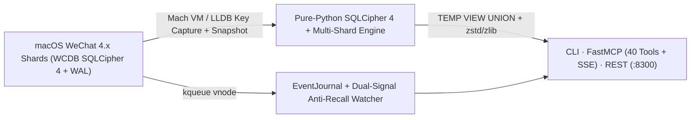

# wechat-mcp

[](https://www.gnu.org/licenses/gpl-3.0)
[](https://www.python.org/)
[](https://www.apple.com/macos/)
[](https://modelcontextprotocol.io/)

**English** | [简体中文](README_CN.md)

Unified macOS WeChat (4.0 / 4.1 / 4.2) **Model Context Protocol (MCP)** server, pure-Python **SQLCipher 4** decryptor, multi-shard query engine, REST API (`:8300`), and anti-recall watcher (`GPL-3.0-or-later`).

## Architecture



## Key Features & Compatibility

- **Pure-Python decryption:** AES-256-CBC + PBKDF2-HMAC-SHA512 with zero native C dependencies; non-blocking 3-tier WAL snapshots.
- **Multi-shard queries & media:** Cross-shard `ATTACH` / `TEMP VIEW` queries, `Name2Id` mapping, WCDB zstd/zlib decompression, SILK→WAV and XOR DAT→JPEG decoding.
- **40 FastMCP tools + REST API:** 30 structured `wechat_core_*` tools (`wechat.core.v1` + PII redaction), 10 legacy aliases, `wechat-core://events/{group}` push, and FastAPI on `:8300`.
- **Anti-recall & link summaries:** Dual-signal (`sysmsg` + vanished-body diff) recall archive plus a 4-stage group-link editorial pipeline.

| WeChat Version | Key Extraction | Module | Requirements |
|---|---|---|---|
| **WeChat 4.0** | Mach VM memory scan | `wechat_mcp.crypto.vm_scan` | `task_for_pid` (`sudo` or entitlements) |
| **WeChat 4.1 / 4.2** | LLDB CommonCrypto breakpoint | `wechat_mcp.crypto.lldb_keys` | `DevToolsSecurity -enable` (no SIP disable) |
| **All 4.x** | SQLCipher 4 decrypt & query | `wechat_mcp.crypto.decrypt` | Full Disk Access for host terminal/IDE |

## Prerequisites & Install

1. Grant **Full Disk Access** to your terminal/IDE under **System Settings → Privacy & Security** so it can read `~/Library/Containers/com.tencent.xinWeChat/Data/Documents/xwechat_files/`.
2. Enable LLDB attachment once (for WeChat 4.1/4.2):
   ```bash
   sudo DevToolsSecurity -enable
   sudo dscl . append /Groups/_developer GroupMembership "$(whoami)"
   ```
3. Install with [Homebrew](https://brew.sh/) (recommended):
   ```bash
   brew install Popcornnnnnnnn/tap/wechat-mcp
   ```
   Update anytime with:
   ```bash
   wechat-mcp upgrade
   ```
   Or install with `uv` from the GitHub Release wheel (or from source):
   ```bash
   uv tool install https://github.com/Popcornnnnnnnn/wechat-mcp/releases/download/v0.1.1/wechat_mcp-0.1.1-py3-none-any.whl
   # or from source:
   git clone https://github.com/Popcornnnnnnnn/wechat-mcp.git && cd wechat-mcp
   pip install .                # or: uv pip install -e ".[dev]"
   ```
   Interactive CLI commands check GitHub Releases at most once every 24 hours (never during `mcp`/`serve` stdio or non-TTY runs); set `WECHAT_MCP_NO_UPDATE_CHECK=1` to disable.

## Quick Start

```bash
wechat-mcp info                                          # discover active account & storage paths
wechat-mcp keys --output ~/.config/wechat-mcp/keys.json  # extract SQLCipher keys (auto LLDB/VM)
wechat-mcp sync                                          # checkpoint WAL & decrypt all shards
wechat-mcp mcp --transport stdio                         # FastMCP stdio server (Claude/Cursor/Antigravity)
wechat-mcp api                                           # REST API on http://127.0.0.1:8300
wechat-mcp recall --interval 2.0                         # real-time anti-recall watcher
wechat-mcp serve --mode all --port 8300 --mcp-port 8301  # REST (:8300) + FastMCP SSE (:8301)
```

Minimal stdio MCP client entry (see [docs/CONFIG.md](docs/CONFIG.md) for full `env` options and client configs):

```json
{
  "mcpServers": {
    "wechat": { "command": "wechat-mcp", "args": ["mcp", "--transport", "stdio"] }
  }
}
```

## Documentation & License

- [FastMCP & REST Tool Reference](docs/TOOLS.md) — all 40 MCP tools, parameters, schemas, SSE push, and REST endpoints
- [Configuration, Clients & Troubleshooting](docs/CONFIG.md) — `config.example.json`, 15 env vars, client snippets, and FAQ
- Licensed under [GPL-3.0-or-later](LICENSE)
