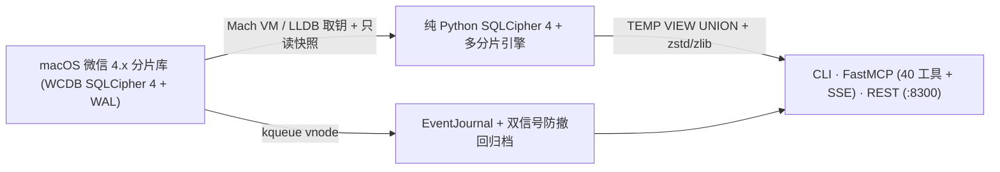

# wechat-mcp

[](https://www.gnu.org/licenses/gpl-3.0)
[](https://www.python.org/)
[](https://www.apple.com/macos/)
[](https://modelcontextprotocol.io/)

[English](README.md) | **简体中文**

面向 macOS 微信（4.0 / 4.1 / 4.2）的统一 **Model Context Protocol (MCP)** 服务、纯 Python **SQLCipher 4** 解密器、多分片查询引擎、REST API（`:8300`）与防撤回监听器（`GPL-3.0-or-later`）。

## 系统架构



## 核心特性与版本兼容

- **纯 Python 解密**：内置 AES-256-CBC + PBKDF2-HMAC-SHA512，无需原生 C 扩展；三级 WAL 快照不锁死微信主进程。
- **多分片查询与媒体解码**：跨分片 `ATTACH`/`TEMP VIEW` 联合查询、`Name2Id` 映射、WCDB zstd/zlib 解压、SILK→WAV 音频与 DAT→JPEG 图片导出。
- **40 个 FastMCP 工具与 REST API**：30 个标准化核心工具（`wechat_core_*`，含 PII 脱敏）、10 个兼容别名、`wechat-core://events/{group}` 资源推送及 `:8300` HTTP 接口。
- **双信号防撤回与链接摘要**：结合 `sysmsg` 与消息消失对比留存撤回内容，并提供群聊链接 4 阶段摘要管线。

| macOS 微信版本 | 密钥提取机制 | 模块 | 权限要求 |
|---|---|---|---|
| **WeChat 4.0** | Mach VM 内存扫描 | `wechat_mcp.crypto.vm_scan` | `task_for_pid`（`sudo` 或开发者授权） |
| **WeChat 4.1 / 4.2** | LLDB CommonCrypto 断点 | `wechat_mcp.crypto.lldb_keys` | `DevToolsSecurity -enable`（无需关闭 SIP） |
| **全 4.x 版本** | SQLCipher 4 解密与查询 | `wechat_mcp.crypto.decrypt` | 运行终端/IDE 需授予完全磁盘访问权限 |

## 前置权限与安装

1. 在 **系统设置 → 隐私与安全性 → 完全磁盘访问权限** 中添加运行 `wechat-mcp` 的终端或 IDE，以读取 `~/Library/Containers/com.tencent.xinWeChat/Data/Documents/xwechat_files/`。
2. 启用 LLDB 调试授权（WeChat 4.1/4.2 需执行一次）：
   ```bash
   sudo DevToolsSecurity -enable
   sudo dscl . append /Groups/_developer GroupMembership "$(whoami)"
   ```
3. 通过 [Homebrew](https://brew.sh/) 安装（推荐）：
   ```bash
   brew install Popcornnnnnnnn/tap/wechat-mcp
   ```
   随时检查并升级：
   ```bash
   wechat-mcp upgrade
   ```
   或使用 `uv` 从 GitHub Release wheel 安装（或从源码安装）：
   ```bash
   uv tool install https://github.com/Popcornnnnnnnn/wechat-mcp/releases/download/v0.1.2/wechat_mcp-0.1.2-py3-none-any.whl
   # 或源码安装：
   git clone https://github.com/Popcornnnnnnnn/wechat-mcp.git && cd wechat-mcp
   pip install .                # 或使用 uv: uv pip install -e ".[dev]"
   ```
   交互式 CLI 命令每 24 小时最多在后台检查一次更新（不会向 `mcp`/`serve` stdio 或非 TTY 输出任何提示）；设置 `WECHAT_MCP_NO_UPDATE_CHECK=1` 可关闭。

## 快速开始

```bash
wechat-mcp info                                          # 识别当前微信账号与存储路径
wechat-mcp keys --output ~/.config/wechat-mcp/keys.json  # 提取数据库密钥（自动选择 LLDB/VM）
wechat-mcp sync                                          # 同步 WAL 并解密全部分片
wechat-mcp mcp --transport stdio                         # 启动 FastMCP stdio 服务
wechat-mcp api                                           # 启动 REST API (127.0.0.1:8300)
wechat-mcp recall --interval 2.0                         # 持续防撤回监控
wechat-mcp serve --mode all --port 8300 --mcp-port 8301  # 同时启动 REST (:8300) 与 SSE (:8301)
```

MCP 客户端最简配置（完整环境变量与客户端示例见 [docs/CONFIG.md](docs/CONFIG.md)）：

```json
{
  "mcpServers": {
    "wechat": { "command": "wechat-mcp", "args": ["mcp", "--transport", "stdio"] }
  }
}
```

## 文档索引与协议

- [FastMCP 与 REST 接口全览](docs/TOOLS.md) — 40 个 MCP 工具参数、输出 Schema、SSE 推送与 REST 接口
- [配置、客户端接入与排查](docs/CONFIG.md) — `config.example.json`、15 个环境变量、客户端配置与 FAQ
- 基于 [GPL-3.0-or-later](LICENSE) 开源协议发布
